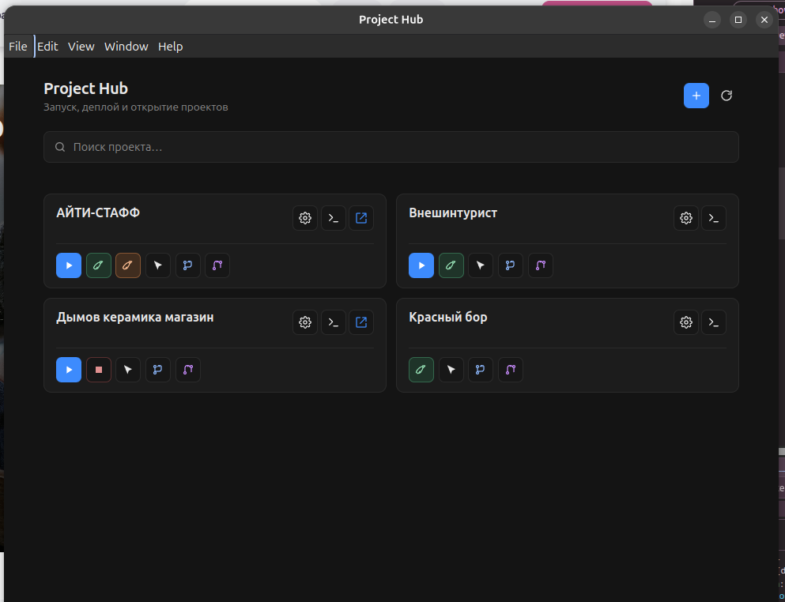

# Project Hub

Локальный дашборд для управления проектами (Ubuntu и macOS): запуск dev-сервера, деплой и открытие репозитория в Cursor.

Electron + Vite + React. Команды выполняются во **внешнем терминале**, без встроенных логов:

- **Linux** — Ptyxis, GNOME Terminal, Kitty и др.
- **macOS** — встроенное приложение **Terminal**



## Возможности

- Список проектов из YAML-конфигов
- **Dev** / **Stop** / **Deploy Dev** / **Deploy Prod** — только если команда задана в конфиге
- **Cursor** — открыть проект через `cursor -n <path>`
- Ярлык: Linux — `.desktop` / `scripts/launch.sh`; macOS — `Project Hub.app` в Dock (см. ниже)

## Установка

```bash
pnpm install
pnpm approve-builds --all   # electron + esbuild (pnpm 10+)
```

## Запуск

```bash
pnpm dev      # разработка (Vite HMR + Electron)
pnpm build    # production-сборка
pnpm start    # Electron из dist/ (на Linux в package.json — --no-sandbox)
```

Или `./scripts/launch.sh` из корня репозитория.

### macOS: иконка в Dock

Один раз собери `.app`, который вызывает `launch.sh` (при необходимости сам сделает `pnpm build`):

```bash
chmod +x scripts/build-icon.sh scripts/install-macos-app.sh scripts/launch.sh
./scripts/build-icon.sh          # icon.svg → icon.png (опционально, install сделает сам)
./scripts/install-macos-app.sh
```

По умолчанию приложение появится в `~/Applications/Project Hub.app`. Другая папка:

```bash
INSTALL_DIR=/Applications ./scripts/install-macos-app.sh
```

Открой приложение или перетащи его в Dock. Нужны **Node/pnpm** в PATH (как для обычного терминала; при использовании nvm — `launch.sh` подхватывает `~/.nvm`).

На **Linux** ярлык в меню — через `.desktop`, указывающий на `scripts/launch.sh` (как раньше в Activities).

## Конфиги проектов

Папка `projects/` в git не коммитится. Создай локально на каждой машине (пути абсолютные, на Mac — `/Users/...`, на Ubuntu — `/home/...`):

```
projects/
  my-app/
    project.yaml
```

Пример `project.yaml`:

```yaml
name: My App
path: /absolute/path/to/repo
url: http://localhost:3000   # или port: 3000
commands:
  dev: pnpm dev
  stop: docker compose down
  "deploy:dev": pnpm deploy:dev
  # "deploy:prod": pnpm deploy:prod
```

Кнопки появляются только для указанных ключей: `dev`, `stop`, `deploy:dev`, `deploy:prod`.


## Docker для проектов

Локальный Docker **не** кладём в корень сайта. Конвенция:

1. Все файлы стека — в `<проект>/.project_hub/` (`docker-compose.yml`, `.env`, nginx/php, скрипты восстановления).
2. В `.gitignore` сайта добавить `/.project_hub/`.
3. В `projects/<id>/project.yaml` команды `dev` / `stop` указывают на `.project_hub/docker-compose.yml`.

На macOS для Docker-команд нужен **Docker Desktop** (или другой локальный Docker).

## Иконка

`resources/icon.png` — иконка окна Electron, `.desktop` на Linux и `.app` на macOS (если файл есть).
